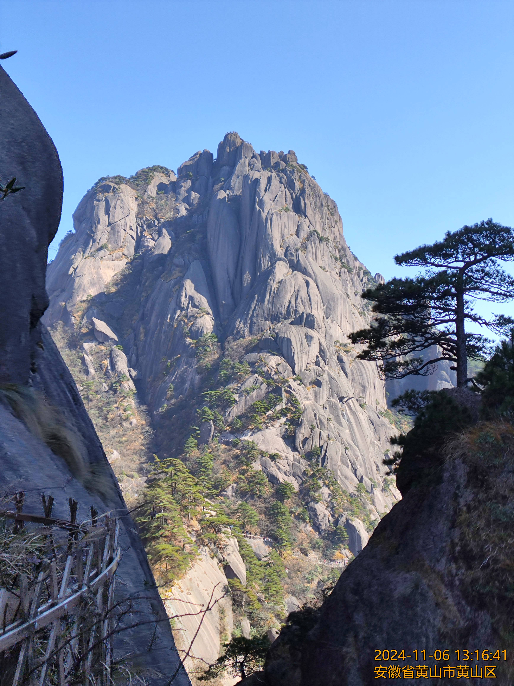

# Jpg-EXIF-Watermarker
批量读取jpg的 EXIF 信息、 GPS 位置，添加水印到照片中。

## 功能特点

- **批量处理**：支持批量处理指定目录下的 `.jpg` 文件。
- **EXIF 信息读取**：读取图片的 EXIF 信息，包括拍摄时间、GPS 位置等。
- **水印添加**：根据配置添加水印，支持自定义水印字体、颜色、位置等。
- **地址信息获取**：通过高德地图 API 根据 GPS 位置获取地址信息。
- **日志记录**：记录处理过程中的日志信息，方便排查问题。
- **多线程处理**：支持配置最大并发数，提高处理效率。

## 配置文件

配置文件为 `config.yaml`，支持注释，默认配置如下：

```yaml
# ==================== 基础设置 ====================
outputFolder: "已处理"           # 处理完成的图片输出目录
noExifFolder: "无EXIF信息"       # 无EXIF信息的图片存放目录
jpegQuality: 70                  # JPEG压缩质量 (1-100)
maxConcurrency: 5                # 并发处理数量

# ==================== 字体设置 ====================
fontPath: "C:/Windows/Fonts/msyh.ttc"  # 字体文件路径

# ==================== 时间格式 ====================
timeFormat: "2006-01-02 15:04:05"      # Go语言时间格式模板

# ==================== 地理位置设置 ====================
amapAPIKey: ""                   # 高德地图API密钥
showFullAddress: false           # 是否显示完整地址

# ==================== 水印设置 ====================
watermarkSettings:
  fontSize: 0.02                 # 字体大小 (相对于图片长边的比例)
  widthPadding: 0.02             # 水印距离右边界距离
  heightPadding: 0.01            # 水印距离底部距离
  color:
    r: 255                       # 红色分量 (0-255)
    g: 165                       # 绿色分量
    b: 0                         # 蓝色分量
    a: 255                       # 透明度 (255=不透明)
```

* `outputFolder`：处理后的图片存放目录。
* `noExifFolder`：无 EXIF 信息的图片存放目录。
* `jpegQuality`：保存图片的 JPEG 品质。
* `amapAPIKey`：高德地图 API 的 Key，用于获取地址信息，可在 [高德控制台](https://console.amap.com/dev/key/app) 申请。
* `maxConcurrency`：最大并发数。
* `fontPath`：水印字体文件路径。
* `timeFormat`：时间格式模板（Go语言格式）。
* `showFullAddress`：是否显示完整地址（true=完整地址，false=省市区）。
* `watermarkSettings`：水印相关设置，包括字体大小、边距、颜色等。
## 使用方法

### 安装依赖：

使用以下命令安装依赖：

```
go get -u github.com/disintegration/imaging
go get -u github.com/golang/freetype
go get -u github.com/rwcarlsen/goexif/exif
```

### 配置文件：

将默认配置文件内容保存为 `config.yaml`，并根据需要修改配置项。

### 运行程序：

将需要处理的 `.jpg` 文件放在程序所在目录下，运行程序：

```
go run main.go
```

也可以下载 `jpg-watermark-cli.exe` 运行。

处理后的图片会存放在配置文件中指定的 `outputFolder` 目录，无 EXIF 信息的图片会存放在 `noExifFolder` 目录。

## 注意事项

* 确保高德地图 API 的 Key 是有效的，否则无法获取地址信息。
* 水印字体文件路径需要正确，否则可能无法正常添加水印。
* 程序会根据图片的 EXIF 信息进行处理，如果图片没有 EXIF 信息，会被复制到 `noExifFolder` 目录。

## 项目结构

* `config.yaml`：配置文件（支持注释）。
* `process.log`：日志文件，记录处理过程中的信息。
